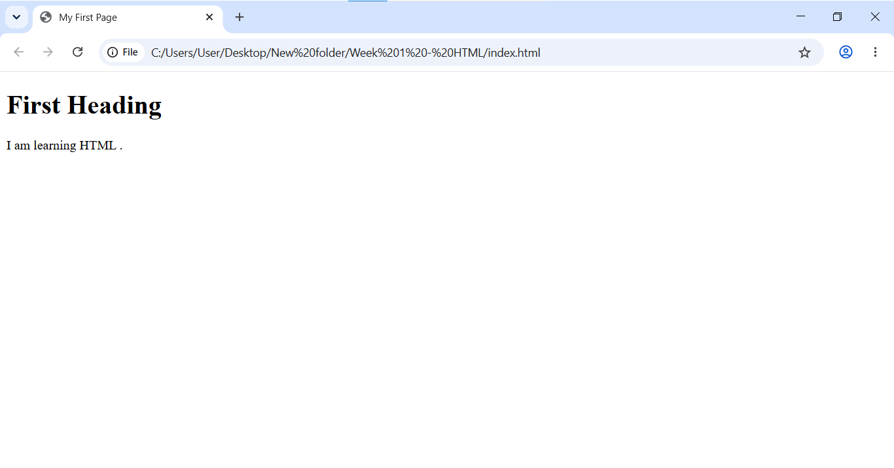
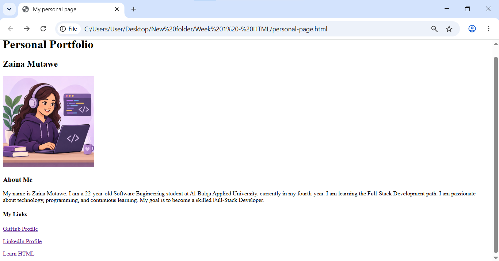
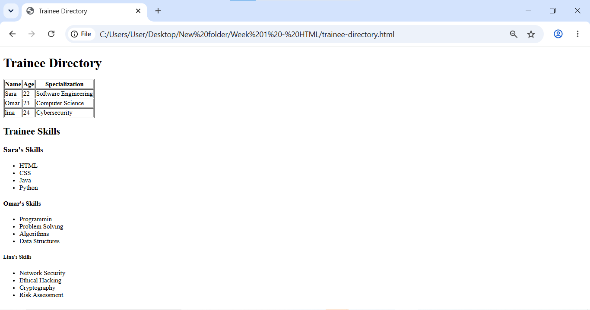
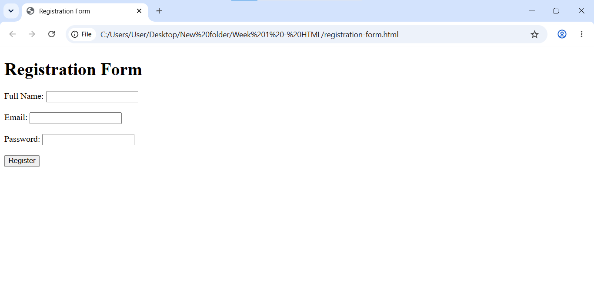
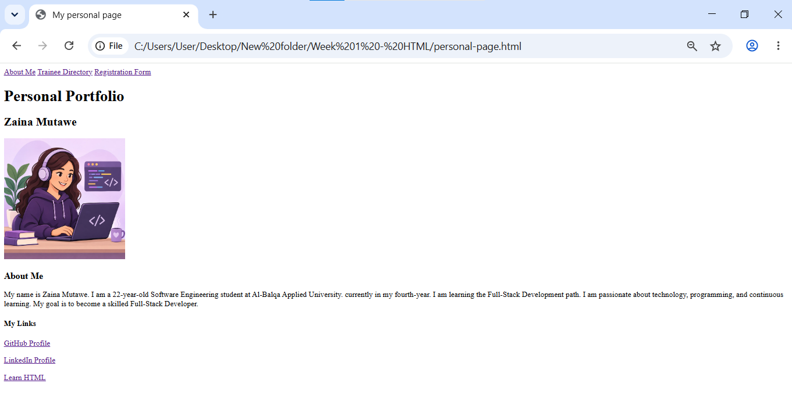

## Week 1 - HTML

# 1. Project Description

This project is part of my Full Stack Java learning journey. It focuses on learning HTML and web development fundamentals.

# 2. Technologies Used

* HTML5
* Visual Studio Code
* Google Chrome

# 3. Project Structure

Week 1 - HTML/
├── images/
│   ├── day-01-page.png
│   ├── day-02-personal-page.png
│   ├── day-03-trainee-directory.png
│   ├── day-04-registration-form.png
│   ├── day-05-portfolio.png
│   └── developer-avatar.png
├── notes/
│   ├── day-01-notes.md
│   ├── day-02-notes.md
│   ├── day-03-notes.md
│   ├── day-04-notes.md
│   └── day-05-notes.md
├── index.html
├── personal-page.html
├── trainee-directory.html
├── registration-form.html
└── README.md
# 4. Setup & Run Instructions

1. Open the project folder in Visual Studio Code.
2. Open index.html using Google Chrome.
3. View the web page in the browser.

# 5. Screenshots
## Day 1 - HTML Page

## Day 2 - Personal Page 

## Day 3 - Trainee Directory 

## Day 4 - Registration Form 

## Day 5 - Final HTML Portfolio 

# 6. Known Limitations

# 7. Learning Progress

### Day 01 - Web & Setup

* Learned about Browser, Server, and HTTP.
* Created my first HTML page.
* Opened the page using Google Chrome.
* Tested the page successfully.
### Day 02 -HTML Structure

- Created a personal portfolio page.
- Practiced headings and paragraphs.
- Added LinkedIn and GitHub links.
- Added an HTML learning resource link.
- Added a developer avatar image.
- Tested all links and the image successfully.

### Day 03 - Lists and Tables
* Created a trainee directory table using HTML.
* Added trainee names, ages, and specializations.
* Created separate skills lists for three trainees.
* Practiced using HTML table elements: <table>, <tr>, <th>, and <td>.
* Practiced using HTML list elements: <ul> and <li>.

### Day 04 - HTML Forms
* Created a registration form using HTML.
* Practiced labels and different input types.
* Used required fields for form validation.
* Tested empty fields and invalid email addresses.

### Day 05 - HTML Portfolio and Navigation
* Connected three HTML pages using navigation links.
* Added a navigation menu to all three pages.
* Tested navigation links between the pages.
* Completed the three-page HTML portfolio.