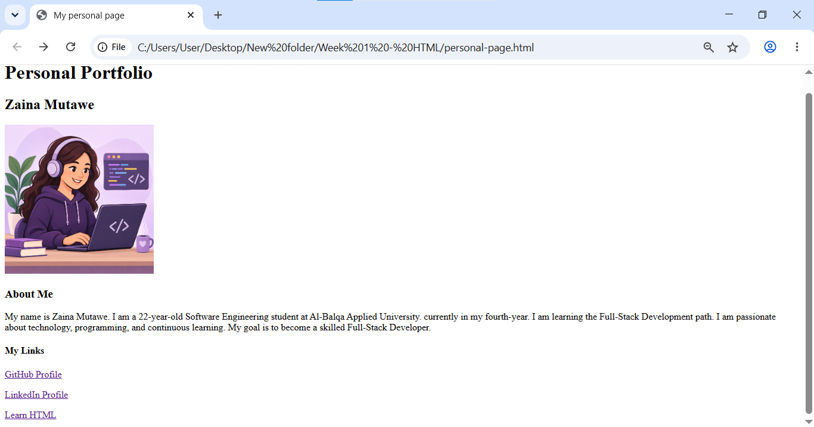

## Full Stack Java Portfolio Project .

# 1. Project Description

This project is part of my Full Stack Java learning journey. It covers HTML and CSS fundamentals, including building and styling a responsive three-page portfolio website.

# 2. Technologies Used

* HTML5
* CSS3
* Visual Studio Code
* Google Chrome

# 3. Project Structure

# 3. Project Structure

Week 1 - HTML/
├── images/
│   ├── day-01-page.png
│   ├── day-02-personal-page.png
│   ├── day-03-trainee-directory.png
│   ├── day-04-registration-form.png
│   ├── day-05-portfolio.png
│   └── developer-avatar.png
├── notes/
│   ├── day-01-notes.md
│   ├── day-02-notes.md
│   ├── day-03-notes.md
│   ├── day-04-notes.md
│   └── day-05-notes.md
├── index.html
├── personal-page.html
├── trainee-directory.html
├── registration-form.html
├── README.md
└── Week 2 - CSS/
    ├── style.css
    ├── images/
    │   ├── day-06-personal-page.png
    │   ├── day-06-registration-form.png
    │   └── day-06-trainee-directory.png
    └── notes/
        └── day-06-notes.md
# 4. Setup & Run Instructions

1. Open the project folder in Visual Studio Code.
2. Open personal-page.html, trainee-directory.html, or registration-form.html.
3. Open the selected HTML page in Google Chrome.
4. Check that the CSS styling is applied correctly.
5. Use the navigation menu to move between the three portfolio pages.

# 5. Screenshots
## Day 1 - HTML Page

## Day 2 - Personal Page 

## Day 3 - Trainee Directory 

## Day 4 - Registration Form 

## Day 5 - Final HTML Portfolio 

### Day 6 - CSS Selectors and Typography 

# 6. Known Limitations
NO Known limitation at this stage.

# 7. Learning Progress

### Day 01 - Web & Setup

* Learned about Browser, Server, and HTTP.
* Created my first HTML page.
* Opened the page using Google Chrome.
* Tested the page successfully.
### Day 02 -HTML Structure

- Created a personal portfolio page.
- Practiced headings and paragraphs.
- Added LinkedIn and GitHub links.
- Added an HTML learning resource link.
- Added a developer avatar image.
- Tested all links and the image successfully.

### Day 03 - Lists and Tables
* Created a trainee directory table using HTML.
* Added trainee names, ages, and specializations.
* Created separate skills lists for three trainees.
* Practiced using HTML table elements: table, tr, th, and td.
* Practiced using HTML list elements: ul, and li.

### Day 04 - HTML Forms
* Created a registration form using HTML.
* Practiced labels and different input types.
* Used required fields for form validation.
* Tested empty fields and invalid email addresses.

### Day 05 - HTML Portfolio and Navigation
* Connected three HTML pages using navigation links.
* Added a navigation menu to all three pages.
* Tested navigation links between the pages.
* Completed the three-page HTML portfolio.

### Day 06 - CSS Selectors and Typography

* Learned how CSS is used to style HTML pages.
* Practiced CSS selectors, colors, and typography.
* Created and connected an external CSS file.
* Styled headings, paragraphs, links, and navigation bars.
* Applied consistent styling to the three portfolio pages.
* Tested CSS styling and navigation links successfully.