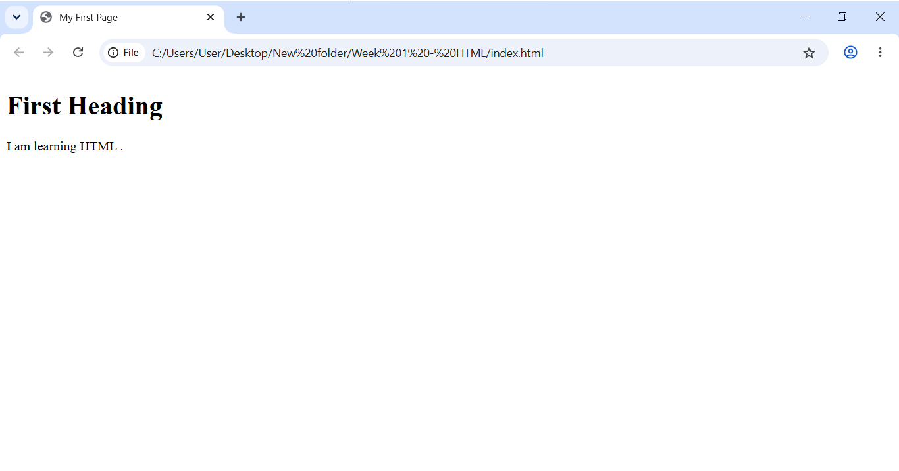
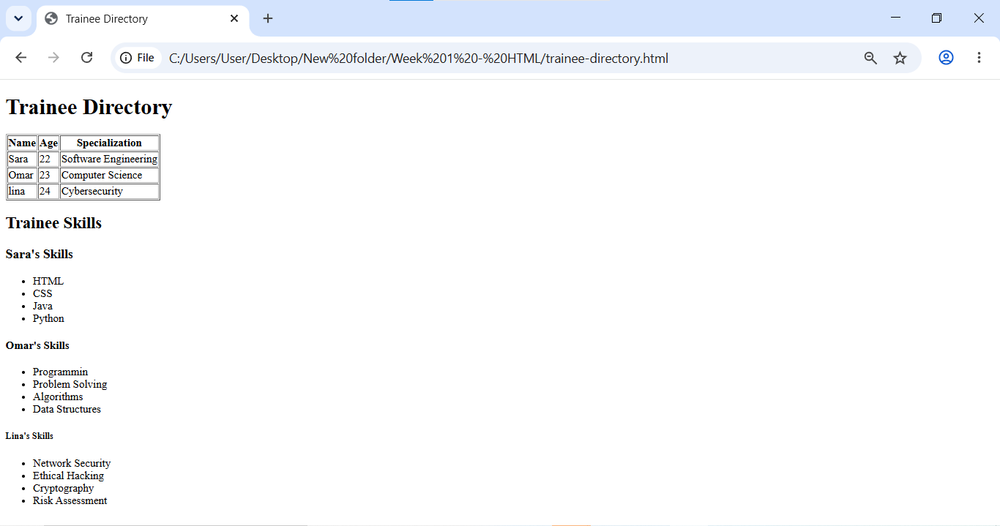
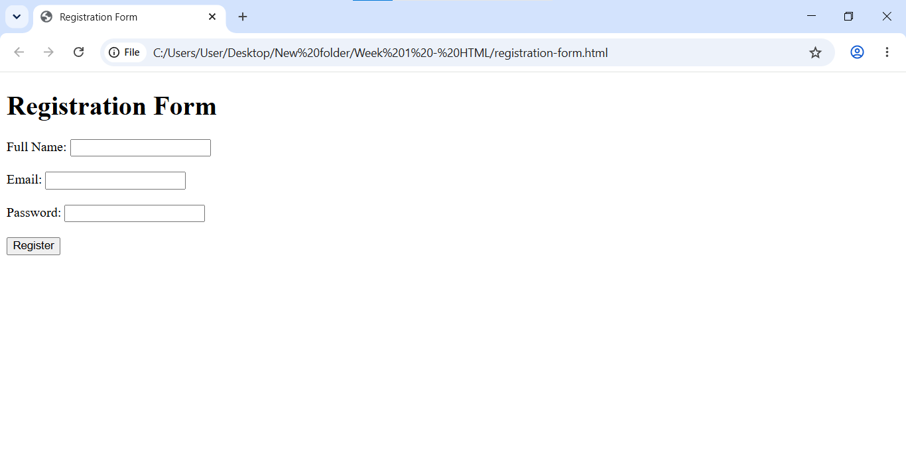
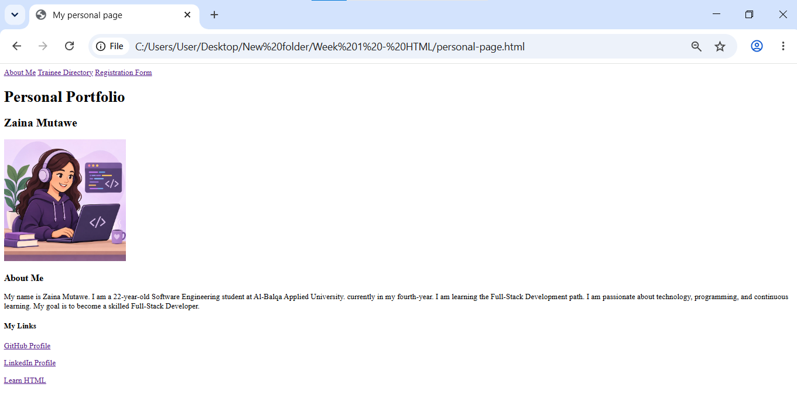

## Full Stack Java Portfolio Project .

# 1. Project Description

This project is part of my Full Stack Java learning journey.

It documents my progress in learning HTML and CSS by building a three-page portfolio website and practicing web development fundamentals.

The project includes HTML structure, navigation, forms, CSS selectors, typography, the CSS box model, and reusable cards.

The project also includes Flexbox layouts with a navigation bar and responsive card row.

# 2. Technologies Used

* HTML5
* CSS3
* Visual Studio Code
* Google Chrome
* Git 
* GitHub

# 3. Project Structure

Week 1 - HTML/
│
├── index.html
├── personal-page.html
├── trainee-directory.html
├── registration-form.html
├── README.md
│
├── images/
│   ├── day-01-page.png
│   ├── day-02-personal-page.png
│   ├── day-03-trainee-directory.png
│   ├── day-04-registration-form.png
│   ├── day-05-portfolio.png
│   └── developer-avatar.png
│
├── notes/
│   ├── day-01-notes.md
│   ├── day-02-notes.md
│   ├── day-03-notes.md
│   ├── day-04-notes.md
│   └── day-05-notes.md
│
└── Week 2 - CSS/
    │
    ├── reusable-cards.html
    ├── flexbox.html
    ├── grid-gallery.html
    ├── style.css
    │
    ├── images/
    │   ├── day-06-personal-page.png
    │   ├── day-06-registration-form.png
    │   ├── day-06-trainee-directory.png
    │   ├── day-07-reusable-cards.png
    │   ├── day-08-flexbox-desktop.png
    │   ├── day-08-flexbox-responsive.png
    │   ├── day-09-grid-desktop.png
    │   ├── day-09-grid-responsive.png
    │   ├── day-10-personal-mobile.png
    │   ├── day-10-personal-tablet.png
    │   ├── day-10-personal-desktop.png
    │   ├── day-10-registration-mobile.png
    │   ├── day-10-registration-tablet.png
    │   ├── day-10-registration-desktop.png
    │   ├── day-10-trainee-mobile.png
    │   ├── day-10-trainee-tablet.png
    │   ├── day-10-trainee-desktop.png
    │   ├── image1.jpg
    │   ├── image2.jpg
    │   ├── image3.jpg
    │   ├── image4.jpg
    │   ├── image5.jpg
    │   └── image6.jpg
    │
    └── notes/
        ├── day-06-notes.md
        ├── day-07-notes.md
        ├── day-08-notes.md
        ├── day-09-notes.md
        └── day-10-notes.md

# 4. Setup & Run Instructions

1. Open the project folder in Visual Studio Code.
2. Open one of the HTML pages:
    * personal-page.html
    * trainee-directory.html
    * registration-form.html
3. Open the selected HTML file in Google Chrome.
4. Check that the CSS styling is displayed correctly.
5. Use the navigation menu to move between the three portfolio pages.

# 5. Screenshots
## Day 1 - HTML Page

## Day 2 - Personal Page 

## Day 3 - Trainee Directory 

## Day 4 - Registration Form 

## Day 5 - Final HTML Portfolio 

### Day 6 - CSS Selectors and Typography 

#### Day 7 - CSS Box Model and Reusable Cards

#### Day 8 - Flexbox

#### Day 9 - CSS Grid

### Day 10 - Media Queries

**Personal Portfolio**

**Registration Form**

**Trainee Directory**

# 6. Known Limitations
NO Known limitation at this stage.

# 7. Learning Progress

### Day 01 - Web & Setup

* Learned about Browser, Server, and HTTP.
* Created my first HTML page.
* Opened the page using Google Chrome.
* Tested the page successfully.
### Day 02 -HTML Structure

- Created a personal portfolio page.
- Practiced headings and paragraphs.
- Added LinkedIn and GitHub links.
- Added an HTML learning resource link.
- Added a developer avatar image.
- Tested all links and the image successfully.

### Day 03 - Lists and Tables
* Created a trainee directory table using HTML.
* Added trainee names, ages, and specializations.
* Created separate skills lists for three trainees.
* Practiced using HTML table elements: table, tr, th, and td.
* Practiced using HTML list elements: ul, and li.

### Day 04 - HTML Forms
* Created a registration form using HTML.
* Practiced labels and different input types.
* Used required fields for form validation.
* Tested empty fields and invalid email addresses.

### Day 05 - HTML Portfolio and Navigation
* Connected three HTML pages using navigation links.
* Added a navigation menu to all three pages.
* Tested navigation links between the pages.
* Completed the three-page HTML portfolio.

### Day 06 - CSS Selectors and Typography

* Learned how CSS is used to style HTML pages.
* Practiced CSS selectors, colors, and typography.
* Created and connected an external CSS file.
* Styled headings, paragraphs, links, and navigation bars.
* Applied consistent styling to the three portfolio pages.
* Tested CSS styling and navigation links successfully.

### Day 07 - CSS Box Model and Reusable Cards

* Learned the CSS box model: content, padding, border, and margin.
* Practiced card sizing and spacing.
* Added borders and rounded corners to reusable cards.
* Created multiple cards using the same CSS class.
* Tested the reusable cards page in Google Chrome.

### Day 08 - Flexbox

* Learned how to use Flexbox to arrange elements.
* Created a navigation bar using Flexbox.
* Arranged three course cards in a responsive row.
* Used flex-wrap to move cards into new rows when screen space becomes smaller.
* Tested the layout on a large and a smaller browser window.

### Day 09 - CSS Grid

* Learned how to create layouts using CSS Grid.
* Created an image gallery with six nature images.
* Used grid columns and spacing to arrange the images.
* Used auto-fit and minmax() to make the gallery responsive.
* Tested the gallery on wide and narrower browser windows.

### Day 10 - Media Queries
- Added tablet and mobile media queries.
- Improved the responsive layout of the portfolio pages.
- Tested the pages on mobile, tablet, and desktop screen sizes.
- Saved screenshots documenting the responsive layouts.
- Completed Day 10 learning notes.